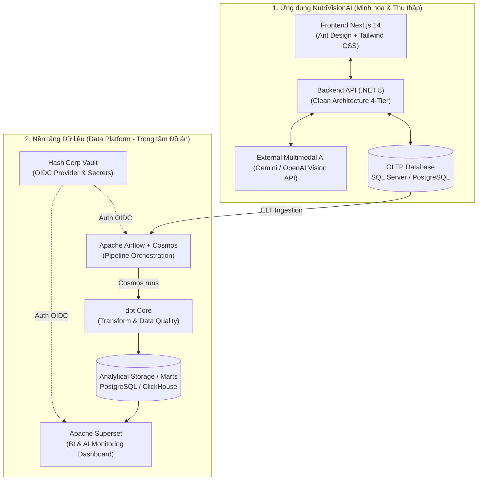

# KẾ HOẠCH TRIỂN KHAI TOÀN DIỆN ĐỒ ÁN TỐT NGHIỆP
## Đề tài: Xây dựng nền tảng dữ liệu cho hệ thống NutriVisionAI hỗ trợ theo dõi và phân tích dinh dưỡng

---

## 1. TỔNG QUAN ĐỀ TÀI & PHẠM VI HỆ THỐNG

Dự án gồm **hai thành phần trụ cột gắn kết chặt chẽ**:



### 1.1. Trụ cột 1: Nền tảng Dữ liệu (Trọng tâm ĐATN)
- **Điều phối & chuyển đổi dữ liệu**: Apache Airflow tích hợp Astronomer Cosmos để quản lý và thực thi dbt DAG.
- **Xử lý dữ liệu (Transformation & Quality)**: dbt Core với mô hình phân lớp (Staging $\rightarrow$ Intermediate $\rightarrow$ Marts) kèm kiểm thử chất lượng dữ liệu tự động (`dbt test`).
- **Bảo mật & Quản lý danh tính**: HashiCorp Vault làm OIDC Provider cho Airflow và Apache Superset, quản lý toàn bộ secrets kết nối.
- **Phân tích & Giám sát chuyên sâu**: Apache Superset trực quan hóa:
  - Báo cáo chất lượng và độ chính xác của AI (`DoTinCay`, tỷ lệ người dùng hiệu chỉnh món, độ lệch calo).
  - Phân tích xu hướng dinh dưỡng tổng hợp trên quy mô lớn.
  - Giám sát trạng thái hoạt động của các Data Pipelines.

### 1.2. Trụ cột 2: Ứng dụng NutriVisionAI (Ứng dụng thực nghiệm)
- **Kiến trúc**: Clean 4-tier Architecture (`Controller` $\rightarrow$ `Service` $\rightarrow$ `Repository` $\rightarrow$ `Entity/DbContext`).
- **Công nghệ đề xuất**:
  - **Backend**: ASP.NET Core Web API (.NET 8), Entity Framework Core, JWT Bearer + ASP.NET Core Identity, Serilog.
  - **Frontend**: Next.js 14 (App Router), React 18, TypeScript, Tailwind CSS, Ant Design, Redux Toolkit.
  - **AI Model**: Gemini Vision API / GPT-4o-mini (nhận diện món ăn, thành phần, khẩu phần qua ảnh).
  - **Storage**: MinIO (S3-compatible chạy local Docker) hoặc Cloudinary.
- **Quy mô nghiệp vụ**:
  - **8 Module chức năng** (48 Functional Requirements từ [FR-01 đến FR-48](file:///d:/%C4%90ATN/Tailieu/pha_phan_tich_2.3.md#L97-L625)).
  - **24 Use Cases** ([UC-01 đến UC-24](file:///d:/%C4%90ATN/Tailieu/pha_phan_tich2.4.md#L1-L126)).
  - **47 Business Rules** ([BR-01 đến BR-47](file:///d:/%C4%90ATN/Tailieu/pha_phan_tich_2.3.md#L711-L903)).
  - **62 Acceptance Criteria** ([AC-01 đến AC-62](file:///d:/%C4%90ATN/Tailieu/pha_phan_tich_2.3.md#L965-L1217)).
  - **9 Bảng CSDL quan hệ** theo chuẩn [ERD chi tiết](file:///d:/%C4%90ATN/Tailieu/phan_tich_erd.md#L5-L900).

---

## 2. KẾ HOẠCH TRIỂN KHAI THEO TỪNG GIAI ĐOẠN (ROADMAP)

Kế hoạch được chia thành **6 Giai đoạn (Phases)**, sắp xếp theo trình tự phụ thuộc kỹ thuật từ thấp lên cao:

```
┌────────────────────────────────────────────────────────────────────────┐
│ Giai đoạn 1: Khởi tạo hạ tầng, CSDL & Môi trường cơ sở (Tuần 1)        │
└───────────────────────────────────┬────────────────────────────────────┘
                                    ▼
┌────────────────────────────────────────────────────────────────────────┐
│ Giai đoạn 2: Xây dựng Backend API NutriVisionAI (.NET 8) (Tuần 2-3)   │
└───────────────────────────────────┬────────────────────────────────────┘
                                    ▼
┌────────────────────────────────────────────────────────────────────────┐
│ Giai đoạn 3: Phát triển Giao diện Frontend (Next.js 14) (Tuần 4-5)     │
└───────────────────────────────────┬────────────────────────────────────┘
                                    ▼
┌────────────────────────────────────────────────────────────────────────┐
│ Giai đoạn 4: Xây dựng Nền tảng Dữ liệu (Airflow + dbt + Superset + Vault) (Tuần 6-7) │
└───────────────────────────────────┬────────────────────────────────────┘
                                    ▼
┌────────────────────────────────────────────────────────────────────────┐
│ Giai đoạn 5: Tích hợp toàn diện, Kiểm thử AC & Đóng gói Docker (Tuần 8)│
└───────────────────────────────────┬────────────────────────────────────┘
                                    ▼
┌────────────────────────────────────────────────────────────────────────┐
│ Giai đoạn 6: Hoàn thiện Thuyết minh ĐATN, Slide & Kịch bản bảo vệ (Tuần 9) │
└────────────────────────────────────────────────────────────────────────┘
```

---

### GIAI ĐOẠN 1: KHỞI TẠO HẠ TẦNG, CSDL & MÔI TRƯỜNG CƠ SỞ (TUẦN 1)

**Mục tiêu:** Thiết lập cấu trúc repo đồng bộ, môi trường container hóa (Docker Compose), tạo CSDL 9 bảng và nạp dữ liệu tham chiếu ban đầu.

- [ ] **Task 1.1: Chuẩn hóa cấu trúc thư mục dự án (Monorepo)**
  - Cấu trúc đề xuất:
    ```text
    ĐATN/
    ├── src/
    │   ├── NutriVision.Api/          # Backend .NET 8 Web API
    │   │   ├── Controllers/
    │   │   ├── Services/
    │   │   ├── Repositories/
    │   │   ├── Models/               # Entities, DTOs, Enums
    │   │   └── Data/                 # ApplicationDbContext, Migrations
    │   └── NutriVision.Web/          # Frontend Next.js 14 (App Router)
    ├── data-platform/                # Data Platform Core
    │   ├── dbt/                      # dbt Project (staging, intermediate, marts)
    │   ├── airflow/                  # Airflow DAGs, plugins, cosmos config
    │   ├── vault/                    # HashiCorp Vault configs & policy scripts
    │   └── superset/                 # Superset dashboard assets & config
    ├── docker/                       # Docker Compose orchestration
    │   ├── docker-compose.infra.yml  # DB, MinIO, Vault
    │   └── docker-compose.full.yml   # Full stack (App + Data Platform)
    ├── docs/                         # Thuyết minh, biểu đồ, tài liệu
    └── Tailieu/                      # Tài liệu phân tích yêu cầu đã có
    ```
- [ ] **Task 1.2: Thiết kế Entities & EF Core Migrations (9 Bảng)**
  - Cài đặt 9 thực thể kế thừa `AuditableEntity` (Soft Delete qua `IsDeleted` / `DaXoa`):
    1. `NguoiDung`: Khóa chính `Id` (GUID), Email duy nhất, `MatKhauHash`, `SoLanDangNhapSai`, `ThoiGianHetHanKhoa`.
    2. `HoSoNguoiDung`: 1-1 với `NguoiDung`, thông tin ngày sinh, giới tính, chiều cao, cân nặng, BMI, BMR, TDEE, Calo mục tiêu.
    3. `TokenLamMoi`: Lưu trữ refresh token, hạn dùng, trạng thái thu hồi.
    4. `ThucPhamThamChieu`: Bảng danh mục thực phẩm chuẩn (Calo/100g, Đạm, Tinh bột, Béo, Xơ).
    5. `BuaAn`: Loại bữa (Sáng/Trưa/Tối/Phụ), Ngày ăn, Tổng Macro, cờ `TaoTuAI`, `DaXacNhan`, `DaXoa`.
    6. `ThanhPhanBuaAn`: Khẩu phần, đơn vị, gram quy đổi, dinh dưỡng thành phần, FK liên kết `ThucPhamThamChieu`.
    7. `TongHopDinhDuongNgay`: Tổng calo, macro theo ngày của từng người dùng.
    8. `LichSuNhanDienAI`: Lưu JSON gốc từ AI, tên món AI đoán, tên món người dùng chốt, độ tin cậy, cờ `NguoiDungCoSua`, độ trễ ms.
    9. `NhatKyHeThong`: Audit log phục vụ quản trị và bảo mật.
- [ ] **Task 1.3: Xây dựng Seeder dữ liệu thực phẩm chuẩn (`ThucPhamThamChieu`)**
  - Tạo script nạp danh mục 50-100 món ăn phổ biến của Việt Nam (phở, cơm tấm, bún chả, bánh mì, trứng ốp la, ức gà, chuối, v.v.) với đầy đủ chỉ số năng lượng và macro tham chiếu trên 100g.
- [ ] **Task 1.4: Khởi chạy môi trường nền tảng bằng Docker Compose**
  - Chạy PostgreSQL / SQL Server + MinIO (lưu trữ ảnh) + MailHog/SmtpMock (kiểm thử gửi email xác thực).

---

### GIAI ĐOẠN 2: PHÁT TRIỂN BACKEND API NUTRIVISIONAI (.NET 8) (TUẦN 2 - 3)

**Mục tiêu:** Xây dựng hoàn chỉnh hệ thống API RESTful đáp ứng 48 Functional Requirements, 47 Business Rules và các tiêu chí chấp nhận (AC).

- [ ] **Task 2.1: Xây dựng Core Framework & Middleware**
  - Generic Repository & Unit of Work pattern.
  - Global Exception Handling Middleware (chuẩn hóa response `{ success, data, message, errors }`).
  - Auditable Entity Interceptor (tự động cập nhật `NgayTao`, `NgayCapNhat`, áp dụng Global Query Filter `!DaXoa`).
- [ ] **Task 2.2: Module 1 — Xác thực & Tài khoản người dùng (FR-01 $\rightarrow$ FR-08)**
  - Đăng ký tài khoản + sinh token gửi email kích hoạt (hạn 24h, dùng 1 lần) (BR-02, BR-04, BR-05).
  - Đăng nhập trả về JWT Access Token (15-60 phút) & Refresh Token; cơ chế khóa 15 phút nếu sai liên tiếp 5 lần (BR-07).
  - Quên mật khẩu (link hết hạn 1h) & Đổi mật khẩu (hủy các refresh token cũ) (BR-06, BR-08, BR-09).
  - Phân quyền theo Role: `User` và `Admin` (chặn 403 Forbidden nếu user vào route admin) (BR-12).
- [ ] **Task 2.3: Module 2 — Hồ sơ cá nhân & Công thức Dinh dưỡng (FR-09 $\rightarrow$ FR-12)**
  - Quản lý Profile (chiều cao 50–200cm, cân nặng 10–150kg, tuổi 10–100) (BR-14, BR-15, BR-16).
  - Tự động tính chỉ số sức khỏe theo công thức khoa học:
    - $\text{BMI} = \frac{\text{Cân nặng (kg)}}{(\text{Chiều cao (m)})^2}$
    - $\text{BMR}$ (Mifflin–St Jeor): 
      - Nam: $10 \times \text{weight} + 6.25 \times \text{height} - 5 \times \text{age} + 5$
      - Nữ: $10 \times \text{weight} + 6.25 \times \text{height} - 5 \times \text{age} - 161$
    - $\text{TDEE} = \text{BMR} \times \text{Hệ số vận động}$
  - Upload avatar lên MinIO/S3 (giới hạn $\le 5\text{MB}$, ảnh jpg/png/webp) (BR-18).
- [ ] **Task 2.4: Module 3 & 4 — Nhận diện AI & Hiệu chỉnh bữa ăn (FR-13 $\rightarrow$ FR-27)**
  - Upload ảnh bữa ăn (kiểm tra $\le 10\text{MB}$, tối thiểu $224 \times 224\text{px}$) (BR-19).
  - Tích hợp AI Vision Service: Gửi ảnh tới Gemini Vision / GPT-4o-mini với Structured Outputs (JSON Schema chuẩn: Tên món, danh sách thành phần, khối lượng ước tính, độ tin cậy confidence).
  - Thiết lập timeout 30s + retry 2 lần; nếu AI lỗi hoặc không nhận diện được $\rightarrow$ fallback mở form nhập tay (BR-20, AC-26, AC-27).
  - Endpoint lưu kết quả AI vào `LichSuNhanDienAI` và lưu bản ghi tạm `BuaAn` với `DaXacNhan = false`.
  - Endpoint xác nhận (`DaXacNhan = true`) và Endpoint hiệu chỉnh (sửa tên món, thêm/sửa/xóa thành phần, cập nhật khối lượng $>0$, cờ `NguoiDungCoSua = true`) (BR-21, BR-22, BR-31).
  - Hủy bữa ăn: Xóa file ảnh tạm trên storage để tiết kiệm dung lượng (BR-25).
- [ ] **Task 2.5: Module 5 — Động cơ Tính toán Dinh dưỡng (FR-28 $\rightarrow$ FR-31)**
  - Tự động mapping từng thành phần với bảng `ThucPhamThamChieu`.
  - Tính năng lượng và dưỡng chất chi tiết:
    $$\text{Nutrient} = \frac{\text{KhoiLuongGram}}{100} \times \text{NutrientTren100g}$$
  - Cộng dồn toàn bộ thành phần ra `TongCalo`, `TongChatDam`, `TongTinhBot`, `TongChatBeo`, `TongChatXo` (AC-36).
  - So sánh với TDEE cá nhân để ra `% Nhu cầu calo đã nạp`.
  - Cập nhật tự động vào bảng `TongHopDinhDuongNgay` ngay khi bữa ăn được xác nhận (BR-26).
- [ ] **Task 2.6: Module 6 & 7 — Lịch sử bữa ăn & Báo cáo Dashboard (FR-32 $\rightarrow$ FR-42)**
  - Lịch sử bữa ăn: Phân trang, lọc theo khoảng ngày (7 ngày, 30 ngày, tùy chọn), lọc theo loại bữa ăn (BR-38). Chỉ chủ sở hữu mới xem/sửa/xóa được bữa ăn của mình (BR-32, BR-33, BR-34). Xóa bữa ăn bằng Soft Delete (BR-35).
  - Dashboard API: Thống kê calo hôm nay, số bữa ăn, biểu đồ tiêu thụ 7 ngày gần nhất so với mục tiêu calo (BR-39). Trả về trạng thái rỗng thân thiện cho người dùng mới (BR-40).
  - Báo cáo dinh dưỡng & Xuất file:
    - Báo cáo xu hướng trung bình/ngày, cơ cấu tỷ lệ Macro (Carbs/Protein/Fat).
    - API xuất báo cáo CSV và PDF (sử dụng QuestPDF hoặc iText7) (FR-41).
- [ ] **Task 2.7: Module 8 — Quản trị Hệ thống Admin (FR-43 $\rightarrow$ FR-48)**
  - Quản lý danh sách người dùng (tìm kiếm, phân trang, khóa/mở khóa tài khoản). Admin không được tự khóa chính mình (BR-13).
  - Chuyển đổi vai trò User $\leftrightarrow$ Admin.
  - Ghi log tự động vào `NhatKyHeThong` cho mọi thao tác quản trị (BR-44).
  - API Thống kê tổng quan cho Admin: Chỉ hiển thị dữ liệu tổng hợp, ẩn danh, tuyệt đối không lộ mật khẩu hay thông tin riêng tư/ảnh bữa ăn cá nhân của user (BR-45, BR-46, BR-47).

---

### GIAI ĐOẠN 3: PHÁT TRIỂN GIAO DIỆN FRONTEND (NEXT.JS 14) (TUẦN 4 - 5)

**Mục tiêu:** Xây dựng giao diện Web hiện đại, responsive theo bản phác thảo tại [luong_thao_tac_va_man_hinh.md](file:///d:/%C4%90ATN/Tailieu/luong_thao_tac_va_man_hinh.md) bằng Next.js 14 App Router, Ant Design và Tailwind CSS.

- [ ] **Task 3.1: Khởi tạo Project & Theme Design System**
  - Cấu hình Next.js 14 App Router + TypeScript.
  - Cài đặt Ant Design, kết hợp Tailwind CSS v4, Redux Toolkit, Axios interceptor (tự động gắn Bearer Token và gọi refresh token khi mã 401).
  - Thiết lập Typography (Inter/Roboto), màu chủ đạo Emerald/Teal hài hòa chủ đề dinh dưỡng.
- [ ] **Task 3.2: Nhóm Màn hình Xác thực & Hồ sơ cá nhân**
  - Đăng ký (Validate form chữ + số $\ge 8$ ký tự, check trùng mật khẩu, thông báo kiểm tra email).
  - Xác thực Email (Trang landing nhận token, thông báo thành công hoặc link hết hạn).
  - Đăng nhập (Lưu token vào cookie/local storage an toàn, hiển thị số lần nhập sai nếu có).
  - Quên mật khẩu & Đặt lại mật khẩu.
  - Trang Hồ sơ cá nhân: Form cập nhật chỉ số chiều cao, cân nặng, tự động hiển thị thẻ BMI/BMR/TDEE kèm phân loại thể trạng, upload avatar với preview cắt ảnh.
- [ ] **Task 3.3: Màn hình Dashboard Người dùng**
  - Thẻ tóm tắt năng lượng hôm nay: Thanh tròn/progress thể hiện Calo đã nạp / Calo mục tiêu (TDEE).
  - Thẻ cơ cấu dinh dưỡng 3 nhóm chất: Đạm, Đường, Béo.
  - Biểu đồ xu hướng Calo 7 ngày gần nhất (Bar Chart / Line Chart).
  - Widget danh sách các bữa ăn đã ghi nhận trong ngày (Sáng, Trưa, Tối, Phụ).
  - Trạng thái rỗng (Empty State) sinh động với nút dẫn nhanh `+ Ghi nhận bữa ăn ngay`.
- [ ] **Task 3.4: Luồng Ghi nhận bữa ăn & Nhận diện AI (Tính năng trọng tâm)**
  - **Màn hình tải ảnh bữa ăn**:
    - Bộ chọn radio/pills 4 loại bữa (tự động gợi ý theo thời gian thực: sáng 6h-9h, trưa 11h-13h, tối 18h-20h).
    - Khu vực kéo thả Dropzone (hỗ trợ kéo thả ảnh, chụp webcam trực tiếp trên thiết bị, validate file $\le 10\text{MB}$).
    - Nút `Tiếp tục nhận diện AI` và nút `Nhập tay món ăn`.
  - **Màn hình xem trước & Hiệu chỉnh kết quả AI (2 cột)**:
    - *Cột trái*: Ảnh món ăn xem trước + Card tổng hợp dinh dưỡng tạm tính (nhảy số realtime khi người dùng đổi khẩu phần).
    - *Cột phải*: Tên món ăn (cho phép click cây bút sửa), Badge độ tin cậy AI (Confidence score), Danh sách các thành phần (tên nguyên liệu, input khẩu phần, dropdown đơn vị: gram/bát/đĩa/miếng, lượng calo tương ứng, nút xóa). Nút `+ Thêm thành phần` (autocomplete từ danh mục thực phẩm).
    - Các nút hành động: `Hoàn tác về AI gốc`, `Hủy bỏ`, và `Xác nhận & Lưu bữa ăn`.
- [ ] **Task 3.5: Màn hình Lịch sử bữa ăn & Chi tiết**
  - Thanh công cụ lọc: Date-range picker (7 ngày, 30 ngày, tùy chọn) + Dropdown loại bữa ăn.
  - Gom nhóm danh sách theo ngày: Hiển thị tổng Calo từng ngày so với mục tiêu.
  - Thẻ Meal Card: Thumbnail ảnh, tag loại bữa, giờ ăn, tên món, các chỉ số Macro tóm tắt.
  - Modal / Trang xem chi tiết bữa ăn (ảnh gốc, thông tin AI ban đầu, chi tiết thành phần, nút Sửa, nút Xóa kèm Modal xác nhận).
- [ ] **Task 3.6: Màn hình Báo cáo dinh dưỡng & Xuất file**
  - Chuyển đổi tab 7 ngày / 30 ngày.
  - Các KPI Cards (Calo trung bình, Đạm, Đường, Béo trung bình/ngày kèm nhãn Đạt chuẩn/Cao/Thấp).
  - Biểu đồ cột xu hướng năng lượng so với đường kẻ khuyến nghị TDEE.
  - Biểu đồ tròn (Donut chart) cơ cấu 3 nhóm chất.
  - Nút `Xuất Báo Cáo PDF` và `Xuất Dữ Liệu CSV`.
- [ ] **Task 3.7: Phân hệ Quản trị Admin**
  - Bảng danh sách người dùng (tìm kiếm, phân trang, badge trạng thái Active/Locked, nút Khóa/Mở khóa, modal đổi Role).
  - Bảng xem Log hoạt động hệ thống (`NhatKyHeThong`) có bộ lọc sự kiện.
  - Dashboard thống kê tổng quan (số user, số bữa ăn ghi nhận, số ảnh AI xử lý, tỷ lệ AI dự đoán chính xác).

---

### GIAI ĐOẠN 4: XÂY DỰNG NỀN TẢNG DỮ LIỆU (DATA PLATFORM) (TUẦN 6 - 7)

**Mục tiêu:** Hiện thực hóa trọng tâm của đồ án: Triển khai Apache Airflow + Astronomer Cosmos + dbt Core + HashiCorp Vault + Apache Superset.

- [ ] **Task 4.1: Cấu hình HashiCorp Vault (Secrets & OIDC Provider)**
  - Chạy Vault server container.
  - Bật Kv2 Secret Engine: Lưu trữ thông tin kết nối database, API keys của AI, JWT Secret.
  - Cấu hình Vault OIDC:
    - Tạo OIDC Client cho Apache Airflow và Apache Superset.
    - Cấu hình nhóm quyền (Admin, Data Engineer, Analyst).
    - Kiểm thử đăng nhập Single Sign-On (SSO) vào Airflow và Superset qua Vault OIDC.
- [ ] **Task 4.2: Xây dựng dbt Project (Data Modeling & Quality Tests)**
  - Khởi tạo dbt project kết nối CSDL phân tích.
  - Xây dựng 3 tầng mô hình hóa dữ liệu (ELT):
    1. **Staging Layer (`stg_`)**:
       - `stg_bua_an`: Làm sạch, chuẩn hóa kiểu ngày tháng, xử lý soft-delete.
       - `stg_thanh_phan`: Chuẩn hóa khối lượng về gram.
       - `stg_ai_logs`: Đọc `LichSuNhanDienAI`, parse trường JSON phản hồi gốc của AI.
       - `stg_thuc_pham`: Danh mục thực phẩm chuẩn hóa.
    2. **Intermediate Layer (`int_`)**:
       - `int_bua_an_thanh_phan_joined`: Kết hợp bữa ăn với dinh dưỡng thực tế.
       - `int_ai_prediction_vs_user_actual`: Tính toán độ lệch giữa tên món AI đoán vs người dùng chốt, độ lệch calo, thời gian AI xử lý.
    3. **Marts Layer (`fct_` & `dim_`)**:
       - `dim_users_nutrition_goal`: Chiều thông tin mục tiêu dinh dưỡng người dùng.
       - `fct_daily_nutrition_summary`: Bảng fact dinh dưỡng tổng hợp hàng ngày.
       - `fct_ai_model_performance`: Bảng fact đánh giá hiệu năng AI (độ chính xác theo loại món, tỷ lệ người dùng phải sửa, phân bổ độ tin cậy confidence).
  - Viết bộ kiểm tra chất lượng dữ liệu (`dbt test`):
    - Kiểm tra `not_null`, `unique`, `accepted_values` trên các khóa chính và trường dinh dưỡng.
    - Custom test: Kiểm tra tổng calo bữa ăn không bị âm, tỷ lệ dinh dưỡng hợp lệ.
- [ ] **Task 4.3: Điều phối Pipeline với Apache Airflow & Astronomer Cosmos**
  - Cài đặt Astronomer Cosmos trong Airflow container.
  - Xây dựng các DAGs điều phối:
    - **DAG 1 (`pipeline_sync_reference_food`)**: Lập lịch định kỳ đồng bộ, làm sạch và cập nhật bảng danh mục thực phẩm tham chiếu.
    - **DAG 2 (`pipeline_daily_nutrition_elt`)**: Lập lịch chạy hàng đêm (00:05 AM), Cosmos tự động parse dbt project thành DAG Airflow, chạy lần lượt staging $\rightarrow$ intermediate $\rightarrow$ marts $\rightarrow$ dbt test.
    - **DAG 3 (`pipeline_ai_monitoring_hourly`)**: Chạy mỗi 2 giờ, tổng hợp các chỉ số drift và hiệu năng nhận diện hình ảnh của AI từ bảng lịch sử.
  - Cấu hình cơ chế cảnh báo (Alert) khi task thất bại và tự động retry (Cosmos execution policy).
- [ ] **Task 4.4: Trực quan hóa & Giám sát trên Apache Superset**
  - Tích hợp Superset kết nối với Data Marts.
  - Thiết kế các Dashboards phân tích chuyên sâu:
    - **Dashboard 1: AI Model Evaluation & Quality Tracking**:
      - Biểu đồ tỷ lệ nhận diện chuẩn xác theo nhóm món ăn (Phở, Cơm, Bún, v.v.).
      - Biểu đồ phân bổ tỷ lệ người dùng phải can thiệp sửa (`NguoiDungCoSua`).
      - Biểu đồ thời gian phản hồi của AI theo khung giờ (`ThoiGianXuLyMs`).
      - Top những món ăn AI hay nhận diện sai nhất cần bổ sung dữ liệu huấn luyện.
    - **Dashboard 2: Platform Nutrition Insights**:
      - Phân tích xu hướng thâm hụt / dư thừa calo của cộng đồng người dùng theo tuần/tháng.
      - Tỷ lệ phân bổ năng lượng bình quân giữa Carbs - Protein - Fat.
      - Giờ ghi nhận bữa ăn phổ biến nhất trong ngày.

---

### GIAI ĐOẠN 5: KIỂM THỬ TOÀN DIỆN, E2E & ĐÓNG GÓI DOCKER (TUẦN 8)

**Mục tiêu:** Xác thực 100% các Acceptance Criteria, kiểm tra các tiêu chuẩn phi chức năng (NFR) và đóng gói trọn gói toàn bộ hệ thống để demo mượt mà.

- [ ] **Task 5.1: Kiểm thử chức năng theo ma trận 62 Acceptance Criteria (AC-01 $\rightarrow$ AC-62)**
  - Bộ phận Auth: Test sai 5 lần khóa 15p (AC-09), link verify email 1 lần (AC-05), link reset mật khẩu (AC-11).
  - Bộ phận Bữa ăn & AI: Test upload ảnh hợp lệ và không hợp lệ (AC-23, AC-24, AC-25), test AI timeout & fallback nhập tay (AC-26, AC-27), test sửa tên món lưu cả 2 giá trị (AC-31), test hoàn tác (AC-35).
  - Bộ phận Quyền riêng tư: Test User A không xem được bữa ăn của User B (AC-44), User không vào được `/admin` (AC-15, AC-62), Admin không xem mật khẩu và ảnh bữa ăn riêng tư của user (AC-58, AC-59).
- [ ] **Task 5.2: Kiểm thử phi chức năng (NFR Verification)**
  - Đo thời gian tải trang: Đảm bảo $\le 2\text{s}$ (NFR-01).
  - Đo thời gian tính toán dinh dưỡng: Đảm bảo $\le 1\text{s}$ (NFR-04).
  - Kiểm thử Responsive trên cả Desktop và thiết bị di động (NFR-12).
  - Kiểm tra an toàn ứng dụng: Phòng chống SQL Injection (EF Core Parameterized Query), XSS, CSRF (NFR-10).
- [ ] **Task 5.3: Đóng gói Docker Compose Một Lệnh (`docker compose up`)**
  - Viết file `docker-compose.yml` liên kết toàn bộ:
    1. `db`: SQL Server hoặc PostgreSQL
    2. `vault`: HashiCorp Vault
    3. `minio`: Lưu trữ hình ảnh
    4. `api`: .NET 8 Backend API
    5. `web`: Next.js 14 Frontend
    6. `airflow`: Airflow Webserver, Scheduler & Cosmos
    7. `superset`: Apache Superset
  - Tạo script khởi tạo tự động (`init-platform.sh` / `init-platform.ps1`): Chạy migrations, nạp seed data, cấu hình vault policy chỉ với 1 cú click.

---

### GIAI ĐOẠN 6: HOÀN THIỆN THUYẾT MINH ĐATN & CHUẨN BỊ BẢO VỆ (TUẦN 9)

**Mục tiêu:** Hoàn thiện quyển báo cáo tốt nghiệp chuẩn học thuật, thiết kế slide thuyết trình ấn tượng và kịch bản demo trực tiếp trước Hội đồng.

- [ ] **Task 6.1: Cấu trúc Quyển Thuyết minh ĐATN (Dự kiến 5 Chương)**
  - **Chương 1: Mở đầu**: Đặt vấn đề, mục tiêu xây dựng Nền tảng dữ liệu cho AI & dinh dưỡng, giới hạn đề tài.
  - **Chương 2: Khảo sát hiện trạng & Cơ sở lý thuyết**:
    - Lý thuyết về Data Platform hiện đại, Orchestration (Airflow, Cosmos), Data Modeling (dbt), Secrets Management & OIDC (Vault), Business Intelligence (Superset).
    - Công nghệ ứng dụng Web (.NET 8, Clean Architecture, Next.js 14, Tailwind CSS, Ant Design).
    - Mô hình AI Vision đa phương thức trong phân tích hình ảnh thực phẩm.
  - **Chương 3: Phân tích & Đặc tả yêu cầu hệ thống**:
    - Tích hợp nội dung từ các file tài liệu: 48 FR, 18 NFR, 47 Business Rules, 24 Use Cases và 62 Acceptance Criteria.
    - Sơ đồ Use Case tổng thể và phân rã các phân hệ.
  - **Chương 4: Thiết kế hệ thống & Nền tảng Dữ liệu**:
    - Sơ đồ kiến trúc tổng thể kết hợp giữa Web App và Data Platform.
    - Thiết kế cơ sở dữ liệu (Database Diagram 9 bảng, từ điển dữ liệu chi tiết).
    - Thiết kế luồng xác thực OIDC với Vault.
    - Thiết kế luồng biến đổi dữ liệu ELT qua dbt và Airflow DAGs.
    - Thiết kế giao diện người dùng (Wireframes & Screen flows).
  - **Chương 5: Cài đặt, Thử nghiệm & Đánh giá**:
    - Kết quả triển khai các phân hệ.
    - Kết quả kiểm thử chức năng và phi chức năng.
    - Báo cáo kết quả phân tích chất lượng AI trên Superset.
  - **Kết luận & Hướng phát triển**.
- [ ] **Task 6.2: Xây dựng Kịch bản Demo Bảo vệ (Live Demo Script)**
  - **Kịch bản 1 (Người dùng cuối)**: Đăng ký $\rightarrow$ Tải ảnh bữa ăn lên $\rightarrow$ AI phân tích nhận diện $\rightarrow$ Người dùng hiệu chỉnh khối lượng $\rightarrow$ Xác nhận $\rightarrow$ Dashboard tự động cập nhật calo & macro $\rightarrow$ Xem lịch sử & Xuất báo cáo PDF.
  - **Kịch bản 2 (Data Platform & Vận hành)**: 
    - Đăng nhập SSO vào Airflow qua Vault OIDC.
    - Kích hoạt Airflow DAG: Cosmos thực thi dbt models biến đổi dữ liệu và chạy tests dữ liệu tự động.
    - Mở Apache Superset qua Vault SSO: Trình diễn Dashboard đánh giá độ chính xác AI, chỉ ra món ăn có tỷ lệ người dùng sửa nhiều nhất.
  - **Kịch bản 3 (Quản trị Admin)**: Đăng nhập quyền Admin $\rightarrow$ Khóa user vi phạm $\rightarrow$ Xem nhật ký thao tác `NhatKyHeThong`.
- [ ] **Task 6.3: Thiết kế Slide Thuyết trình (PowerPoint/Canva)**
  - 25-30 slides súc tích, trực quan, làm nổi bật tính mới và độ phức tạp kỹ thuật của đề tài (không phải làm app CRUD thông thường mà là hệ thống nền tảng dữ liệu chuẩn doanh nghiệp).

---

## 3. CHECKLIST MA TRẬN ÁNH XẠ TIÊU CHÍ (TRACEABILITY MATRIX)

Để đảm bảo không bỏ sót bất kỳ chi tiết nào trong các tài liệu phân tích, ma trận dưới đây liên kết các yêu cầu cốt lõi:

| Nhóm chức năng | Use Case | Functional Req (FR) | Business Rule (BR) | Acceptance Criteria (AC) | Bảng CSDL liên quan |
| :--- | :--- | :--- | :--- | :--- | :--- |
| **Xác thực & Tài khoản** | UC-01 $\rightarrow$ UC-06 | FR-01 $\rightarrow$ FR-08 | BR-01 $\rightarrow$ BR-13 | AC-01 $\rightarrow$ AC-16 | `NguoiDung`, `TokenLamMoi` |
| **Hồ sơ cá nhân** | UC-07 $\rightarrow$ UC-09 | FR-09 $\rightarrow$ FR-12 | BR-14 $\rightarrow$ BR-18 | AC-17 $\rightarrow$ AC-22 | `HoSoNguoiDung` |
| **Ghi nhận bữa ăn** | UC-10, UC-11 | FR-13 $\rightarrow$ FR-20 | BR-19, BR-20, BR-24, BR-25 | AC-23 $\rightarrow$ AC-28 | `BuaAn`, `LichSuNhanDienAI` |
| **Hiệu chỉnh & Xác nhận** | UC-12, UC-13 | FR-21 $\rightarrow$ FR-27 | BR-21 $\rightarrow$ BR-23, BR-27, BR-31 | AC-29 $\rightarrow$ AC-35 | `BuaAn`, `ThanhPhanBuaAn`, `LichSuNhanDienAI` |
| **Tính toán dinh dưỡng** | UC-14 | FR-28 $\rightarrow$ FR-31 | BR-26, BR-29, BR-30 | AC-36 $\rightarrow$ AC-39 | `ThucPhamThamChieu`, `TongHopDinhDuongNgay` |
| **Lịch sử bữa ăn** | UC-15 $\rightarrow$ UC-18 | FR-32 $\rightarrow$ FR-37 | BR-28, BR-32 $\rightarrow$ BR-37 | AC-40 $\rightarrow$ AC-46 | `BuaAn`, `ThanhPhanBuaAn` |
| **Dashboard & Báo cáo** | UC-19 $\rightarrow$ UC-21 | FR-38 $\rightarrow$ FR-42 | BR-38 $\rightarrow$ BR-42 | AC-47 $\rightarrow$ AC-53 | `TongHopDinhDuongNgay`, `BuaAn` |
| **Quản trị hệ thống** | UC-22 $\rightarrow$ UC-24 | FR-43 $\rightarrow$ FR-48 | BR-43 $\rightarrow$ BR-47 | AC-54 $\rightarrow$ AC-62 | `NhatKyHeThong`, `NguoiDung` |
| **Data Platform ELT** | Pipeline DAGs | Nền tảng dbt / Cosmos | Quản lý chất lượng dữ liệu | Data Marts / Superset | `fct_daily_nutrition`, `fct_ai_performance` |
| **Quản lý Secrets & SSO**| Vault OIDC | Xác thực Airflow, Superset | Bảo mật secrets tập trung | Đăng nhập tập trung OIDC | HashiCorp Vault Engine |

---

## 4. CHIẾN LƯỢC BẢO VỆ VÀ TRẢ LỜI CÂU HỎI CỦA HỘI ĐỒNG

Khi bảo vệ trước Hội đồng chấm ĐATN, các thầy cô thường tập trung vào các câu hỏi kỹ thuật chuyên sâu sau:

1. **"Tại sao đề tài đặt tên là 'Nền tảng dữ liệu' nhưng lại làm cả ứng dụng NutriVisionAI?"**
   - *Cách trả lời:* NutriVisionAI đóng vai trò là ứng dụng thực nghiệm (Demonstrator Application) nhằm tạo ra nguồn dữ liệu thực tế (dữ liệu hình ảnh, phản hồi AI, hiệu chỉnh người dùng). Trọng tâm đề tài là xây dựng Nền tảng dữ liệu (Data Platform) với dbt, Astronomer Cosmos, Airflow, Vault và Superset để tự động hóa việc thu thập, làm sạch, kiểm tra chất lượng dữ liệu và phân tích hiệu năng của AI. Nếu không có ứng dụng minh họa, nền tảng dữ liệu sẽ thiếu nguồn dữ liệu nghiệp vụ để kiểm chứng.

2. **"Kiến trúc dbt + Astronomer Cosmos + Airflow mang lại ưu thế gì so với việc viết Airflow DAG thông thường?"**
   - *Cách trả lời:* Nếu dùng Airflow thuần với Python/SQL Operator, việc quản lý phụ thuộc (lineage), kiểm thử chất lượng dữ liệu và version control rất phân tán và phức tạp. Astronomer Cosmos cho phép load trực tiếp dbt project thành các Airflow DAGs một cách tự động, tận dụng thế mạnh phân lớp dữ liệu (Staging - Intermediate - Marts) và data testing của dbt, đồng thời vẫn giữ được khả năng lập lịch, retry và giám sát mạnh mẽ của Airflow.

3. **"Vai trò của HashiCorp Vault trong hệ thống là gì?"**
   - *Cách trả lời:* Vault đóng 2 vai trò cốt lõi: (1) Quản lý tập trung các Secret (chuỗi kết nối CSDL, API Keys AI) theo cơ chế Least Privilege, tránh hardcode trong repo; (2) Đóng vai trò OIDC Provider để thực hiện xác thực tập trung (Single Sign-On) cho cả Apache Airflow và Apache Superset, đáp ứng tiêu chuẩn an toàn bảo mật doanh nghiệp.

4. **"Dữ liệu nhận diện AI được kiểm soát chất lượng như thế nào?"**
   - *Cách trả lời:* Hệ thống áp dụng quy tắc nghiệp vụ BR-27 và BR-31: Kết quả AI chỉ mang tính tham khảo ban đầu. Dữ liệu chỉ được tính vào dinh dưỡng chính thức khi người dùng xác nhận (`DaXacNhan = true`). Hệ thống lưu trữ cả dữ liệu AI dự đoán ban đầu và dữ liệu sau khi người dùng chốt trong bảng `LichSuNhanDienAI`, qua đó pipeline dbt sẽ phân tích độ lệch để đo lường độ chính xác và drift của mô hình AI trên Apache Superset.

---

## 5. BƯỚC HÀNH ĐỘNG TIẾP THEO (NEXT STEPS)

Để bắt đầu ngay lập tức mà không bị ngợp, hãy chọn một trong các bước khởi động dưới đây:

1. **Khởi tạo Repo & Cấu trúc Thư mục**: Thiết lập monorepo chuẩn (`src/NutriVision.Api`, `src/NutriVision.Web`, `data-platform/`, `docker/`).
2. **Khởi tạo Database & Migrations**: Viết mã Entity Framework Core cho 9 bảng theo đúng chuẩn trong `phan_tich_erd.md` và tạo file migration đầu tiên.
3. **Dựng file Docker Compose**: Dựng database, MinIO và Vault để sẵn sàng môi trường dev.
