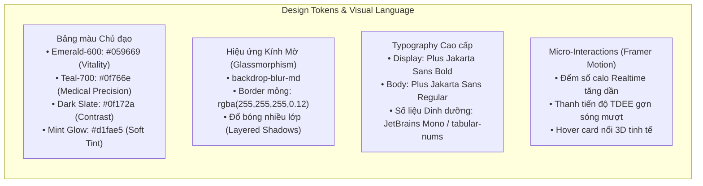

# KẾ HOẠCH PHÁT TRIỂN PHÂN HỆ WEB NUTRIVISION AI
## (Next.js 14 App Router + ASP.NET Core .NET 8 Web API)
### Phong cách thiết kế: **Modern Health-Tech** (Emerald / Teal / Glassmorphism / Plus Jakarta Sans)

---

## 1. ĐỊNH HƯỚNG THIẾT KẾ UI/UX (DESIGN SYSTEM & AESTHETICS)

Để đạt điểm xuất sắc và tạo ấn tượng **"WOW"** với Hội đồng bảo vệ ngay từ ánh nhìn đầu tiên, giao diện sẽ được xây dựng theo ngôn ngữ thiết kế **Modern Health-Tech**:



### 1.1. Các thành phần thị giác cốt lõi (Visual Anchors)
1. **Real-time Calorie & Macro Counter**: Khi người dùng tăng/giảm khẩu phần món ăn ở màn hình hiệu chỉnh, bảng tóm tắt dinh dưỡng bên cột trái sẽ có hiệu ứng chuyển số mượt mà (smooth number transition) chứ không giật cục.
2. **Interactive Dropzone & Webcam Scanner**: Khu vực tải ảnh dạng hộp quét công nghệ cao (scanner viewfinder), có tia quét laser nhẹ khi AI đang xử lý, hỗ trợ cả kéo thả ảnh và bật trực tiếp camera thiết bị.
3. **Macro Ratio Ring & Progress Bar**: Biểu đồ tròn Donut phân tách 3 màu rõ rệt: Đạm (Xanh dương hoàng gia `#3b82f6`), Tinh bột (Vàng hổ phách `#f59e0b`), Chất béo (Hồng san hô `#f43f5e`), ở giữa là tổng Calo to, sắc nét.
4. **Dark & Light Mode Ready**: Nền tối sâu thẳm kiểu Slate (`#0b0f19`) hoặc nền sáng tinh khiết kiểu Frost Snow (`#f8fafc`) tôn vinh màu xanh ngọc của thực phẩm và sức khỏe.

---

## 2. KIẾN TRÚC KỸ THUẬT PHÂN HỆ WEB

Hệ thống được chia thành 2 project trong cùng thư mục `src/`:

```text
d:/ĐATN/
├── src/
│   ├── NutriVision.Api/              # Backend .NET 8 Web API (Clean Architecture)
│   │   ├── Controllers/              # 8 API Controllers chuẩn RESTful
│   │   ├── Services/                 # Business logic, Mifflin-St Jeor, AI Vision Client
│   │   ├── Repositories/             # Generic Repo, Auditable Query Filter (!DaXoa)
│   │   ├── Models/
│   │   │   ├── Entities/             # 9 Entities theo ERD
│   │   │   └── DTOs/                 # Requests, Responses, Validations
│   │   └── Data/
│   │       ├── ApplicationDbContext.cs
│   │       ├── Seeders/              # Nạp danh mục ThucPhamThamChieu chuẩn
│   │       └── Migrations/
│   │
│   └── NutriVision.Web/              # Frontend Next.js 14 (App Router)
│       ├── app/
│       │   ├── (auth)/               # Login, Register, Verify Email, Forgot Password
│       │   ├── (dashboard)/          # Dashboard tổng quan, Lịch sử, Báo cáo, Profile
│       │   ├── meal/                 # Luồng ghi nhận bữa ăn: Scan, Review & Adjust
│       │   └── admin/                # Quản lý User, Log hệ thống, Thống kê
│       ├── components/
│       │   ├── ui/                   # Button, Input, Modal, Badge, Dropzone
│       │   ├── charts/               # Recharts / Chart.js biểu đồ dinh dưỡng
│       │   └── layout/               # Modern Sidebar, Glass Navbar, Breadcrumbs
│       ├── lib/                      # Axios client, Auth helpers, Nutrition calculator
│       └── store/                    # Redux Toolkit / Zustand state slices
│
└── docker-compose.yml                # SQL Server / Postgres + MinIO + Web + Api
```

---

## 3. LỘ TRÌNH THỰC HIỆN CHI TIẾT (5 GIAI ĐOẠN)

### GIAI ĐOẠN 1: KHỞI TẠO NỀN TẢNG & CƠ SỞ DỮ LIỆU (TUẦN 1)

**Mục tiêu:** Dựng xong khung .NET 8 API + Next.js 14, tạo CSDL 9 bảng theo đúng [phan_tich_erd.md](file:///d:/%C4%90ATN/Tailieu/phan_tich_erd.md) và thiết lập design tokens.

- [ ] **Task 1.1: Khởi tạo Project Backend (.NET 8 Web API)**
  - Cài đặt các gói NuGet:
    - `Microsoft.EntityFrameworkCore.SqlServer` (hoặc `Npgsql.EntityFrameworkCore.PostgreSQL`)
    - `Microsoft.EntityFrameworkCore.Design` & `Tools`
    - `Microsoft.AspNetCore.Authentication.JwtBearer`
    - `FluentValidation.AspNetCore`
    - `Serilog.AspNetCore` & `Serilog.Sinks.File`
    - `QuestPDF` hoặc `EPPlus` (phục vụ xuất PDF & Excel/CSV)
  - Cấu hình Swagger / OpenAPI với nút Authorize JWT Bearer.
- [ ] **Task 1.2: Định nghĩa 9 Bảng Entity & EF Core Migrations**
  - Tạo lớp `BaseEntity` / `AuditableEntity`: `Id (Guid)`, `NgayTao`, `NgayCapNhat`, `DaXoa (bool)` kèm Global Query Filter.
  - Cài đặt 9 Entities chuẩn hóa:
    1. `NguoiDung`: `Id`, `Email`, `EmailDaXacThuc`, `MatKhauHash`, `HoTen`, `TrangThai`, `SoLanDangNhapSai`, `ThoiGianHetHanKhoa`, `VaiTro`.
    2. `HoSoNguoiDung`: Khóa ngoại 1-1 với `NguoiDung`, `NgaySinh`, `GioiTinh`, `ChieuCao`, `CanNang`, `MucDoVanDong`, `ChiSoBMI`, `ChiSoBMR`, `ChiSoTDEE`, `MucTieuCalo`, `DuongDanAnhDaiDien`.
    3. `TokenLamMoi`: `NguoiDungId`, `MaToken`, `ThoiGianHetHan`, `DaSuDung`, `DaThuHoi`.
    4. `ThucPhamThamChieu`: `MaThucPham`, `TenThucPham`, `NhomThucPham`, `DonViChuan`, `KhoiLuongChuan`, `CaloTren100g`, `ChatDamTren100g`, `TinhBotTren100g`, `ChatBeoTren100g`, `ChatXoTren100g`, `DangHoatDong`.
    5. `BuaAn`: `NguoiDungId`, `LoaiBuaAn`, `NgayAn`, `ThoiGianGhiNhan`, `TenMonAn`, `DuongDanHinhAnh`, `TongCalo`, `TongChatDam`, `TongTinhBot`, `TongChatBeo`, `TongChatXo`, `TaoTuAI`, `DaXacNhan`, `DaXoa`.
    6. `ThanhPhanBuaAn`: `BuaAnId`, `ThucPhamThamChieuId`, `TenThanhPhan`, `KhauPhan`, `DonViTinh`, `KhoiLuongQuyDoiGram`, `LuongCalo`, `LuongChatDam`, `LuongTinhBot`, `LuongChatBeo`, `LuongChatXo`.
    7. `TongHopDinhDuongNgay`: `NguoiDungId`, `Ngay`, `TongCalo`, `TongChatDam`, `TongTinhBot`, `TongChatBeo`, `TongChatXo`, `SoBuaAnDaGhi`, `MucTieuCaloNgay`.
    8. `LichSuNhanDienAI`: `NguoiDungId`, `BuaAnId`, `DuongDanHinhAnh`, `PhanHoiAIGoc`, `TenMonAIDoan`, `TenMonNguoiDungChot`, `DoTinCay`, `NguoiDungCoSua`, `ThoiGianXuLyMs`.
    9. `NhatKyHeThong`: `NguoiDungThucHienId`, `LoaiHanhDong`, `BangTacDong`, `IdDoiTuong`, `ChiTiet`, `DiaChiIP`, `NgayTao`.
  - Nạp Seed Data cho `ThucPhamThamChieu`: 80-100 món ăn phổ thông Việt Nam (phở, cơm tấm, bún riêu, bánh mì, chuối, trứng, ức gà...).
- [ ] **Task 1.3: Khởi tạo Project Frontend (Next.js 14 App Router)**
  - Setup TypeScript + Tailwind CSS + Ant Design.
  - Cài đặt Google Font **Plus Jakarta Sans** và thiết lập biến màu CSS (`--primary: #059669`, `--teal: #0f766e`, `--bg-glass: rgba(255,255,255,0.7)`).
  - Cài đặt các thư viện then chốt: `lucide-react`, `framer-motion`, `recharts`, `axios`, `react-dropzone`, `canvas-confetti`.

---

### GIAI ĐOẠN 2: XÂY DỰNG TOÀN DIỆN BACKEND API (.NET 8) (TUẦN 2 - 3)

**Mục tiêu:** Cài đặt xong toàn bộ 8 Controller với 48 FRs, 47 BRs và test kỹ với Swagger.

- [ ] **Task 2.1: Module 1 — Authentication & Authorization API (FR-01 $\rightarrow$ FR-08)**
  - `POST /api/auth/register`: Validate email duy nhất (BR-02), password băm qua `BCrypt` hoặc `PBKDF2` (BR-01, BR-10), sinh email confirmation token hết hạn sau 24h (BR-04, BR-05, AC-01).
  - `GET /api/auth/verify-email?token=...`: Kích hoạt tài khoản, chỉ dùng 1 lần (AC-04, AC-05, AC-06).
  - `POST /api/auth/login`: Trả về Access Token + Refresh Token (AC-07). Nếu tài khoản chưa verify email $\rightarrow$ chặn đăng nhập (BR-03, AC-08). Đếm số lần đăng nhập sai, nếu sai 5 lần liên tiếp $\rightarrow$ khóa tài khoản 15 phút (BR-07, AC-09).
  - `POST /api/auth/refresh-token`: Cấp lại JWT và thu hồi token cũ.
  - `POST /api/auth/logout`: Thu hồi Refresh Token (AC-10).
  - `POST /api/auth/forgot-password` & `reset-password`: Hết hạn sau 1h (BR-06, BR-11, AC-11, AC-12).
  - `POST /api/auth/change-password`: Hủy toàn bộ refresh token cũ để buộc các thiết bị khác logout (BR-08, BR-09, AC-13, AC-14).
  - Middleware phân quyền `[Authorize(Roles = "Admin")]` và `[Authorize(Roles = "User")]` (BR-12, AC-15).
- [ ] **Task 2.2: Module 2 — Hồ sơ cá nhân & Động cơ Tính chỉ số Sức khỏe (FR-09 $\rightarrow$ FR-12)**
  - `GET /api/profile`: Trả về thông tin cá nhân và các chỉ số thể trạng (AC-17).
  - `PUT /api/profile`: Cập nhật chiều cao (50-200cm), cân nặng (10-150kg), tuổi (10-100) (BR-14 $\rightarrow$ BR-16, AC-18 $\rightarrow$ AC-21).
  - Công thức Mifflin–St Jeor tự động tính lại ngay khi đổi cân nặng/chiều cao:
    - $\text{BMI} = \text{kg} / (\text{m})^2$
    - $\text{BMR}_{\text{Nam}} = 10 \times W + 6.25 \times H - 5 \times A + 5$
    - $\text{BMR}_{\text{Nữ}} = 10 \times W + 6.25 \times H - 5 \times A - 161$
    - $\text{TDEE} = \text{BMR} \times \text{Hệ số vận động}$
  - `POST /api/profile/avatar`: Upload ảnh đại diện $\le 5\text{MB}$ (BR-18, AC-22).
- [ ] **Task 2.3: Module 3 & 4 — Nhận diện AI, Xác nhận & Hiệu chỉnh bữa ăn (FR-13 $\rightarrow$ FR-27)**
  - `POST /api/meal/upload-scan`:
    - Nhận file ảnh $\le 10\text{MB}$, kích thước $\ge 224 \times 224\text{px}$ (BR-19, AC-24, AC-25).
    - Gọi dịch vụ Vision AI (Gemini Flash Vision / OpenAI Vision) với prompt chuẩn yêu cầu trả về JSON Structured Output gồm: `TenMonAn`, `DoTinCay`, và danh sách `ThanhPhan` (tên, khẩu phần, đơn vị, gram).
    - Timeout 30s + Retry 2 lần. Nếu AI fail hoặc trả rỗng $\rightarrow$ trả cờ báo client mở form nhập tay (BR-20, AC-26, AC-27).
    - Lưu vào `LichSuNhanDienAI` và tạo bản ghi tạm `BuaAn` với `DaXacNhan = false`.
  - `POST /api/meal/confirm`: Chuyển `DaXacNhan = true`, kích hoạt tính toán dinh dưỡng và ghi vào `TongHopDinhDuongNgay` (BR-26, AC-29).
  - `PUT /api/meal/{id}/adjust`:
    - Cho phép hiệu chỉnh tên món (lưu cả tên gốc và tên chốt) (BR-31, AC-31).
    - Cho phép thêm/sửa/xóa thành phần (bắt buộc $\ge 1$ thành phần, khẩu phần $>0$) (BR-21, BR-22, BR-23, AC-32, AC-33, AC-34).
    - Cập nhật cờ `NguoiDungCoSua = true` trong `LichSuNhanDienAI`.
  - `POST /api/meal/{id}/revert`: Khôi phục lại chính xác kết quả ban đầu của AI từ `PhanHoiAIGoc` (AC-35).
  - `DELETE /api/meal/{id}/cancel`: Hủy ghi nhận bữa ăn, xóa file ảnh tạm đã tải lên để tiết kiệm dung lượng (BR-24, BR-25, AC-28).
- [ ] **Task 2.4: Module 5 — Động cơ Tính toán Dinh dưỡng (FR-28 $\rightarrow$ FR-31)**
  - Tự động map tên thành phần với `ThucPhamThamChieu` (sử dụng text matching gần đúng hoặc ID).
  - Tính toán: $\text{Macro} = (\text{Gram} / 100) \times \text{Macro100g}$.
  - Tổng hợp ra `TongCalo`, `TongChatDam`, `TongTinhBot`, `TongChatBeo`, `TongChatXo` (AC-36).
  - So sánh với TDEE: Trả về `% Nhu cầu năng lượng đã nạp` (AC-39).
- [ ] **Task 2.5: Module 6 & 7 — Lịch sử bữa ăn, Dashboard & Báo cáo (FR-32 $\rightarrow$ FR-42)**
  - `GET /api/meal/history`: Phân trang, lọc theo khoảng ngày (7d, 30d, custom), lọc theo loại bữa ăn (Sáng, Trưa, Tối, Phụ). Đảm bảo người dùng chỉ xem được bữa ăn của mình (BR-32, BR-33, AC-40 $\rightarrow$ AC-44).
  - `PUT /api/meal/{id}` & `DELETE /api/meal/{id}`: Sửa và xóa bữa ăn đã lưu (áp dụng Soft Delete `DaXoa = true`) (BR-34, BR-35, AC-45, AC-46).
  - `GET /api/dashboard`: Thống kê calo hôm nay, số bữa ăn, biểu đồ 7 ngày gần nhất, tỷ lệ đạm/đường/béo so với mục tiêu. Trả về trạng thái rỗng nếu chưa có dữ liệu (BR-39, BR-40, AC-47, AC-48). Chỉ tính các bữa ăn đã confirmed (BR-28, AC-49).
  - `GET /api/report`: Thống kê trung bình ngày, xu hướng calo, tỷ lệ macro theo khoảng thời gian tùy chọn (AC-50, AC-51).
  - `GET /api/report/export-pdf` & `GET /api/report/export-csv`: Xuất file báo cáo dinh dưỡng cá nhân hóa (FR-41, AC-52).
- [ ] **Task 2.6: Module 8 — Phân hệ Quản trị Admin API (FR-43 $\rightarrow$ FR-48)**
  - `GET /api/admin/users`: Danh sách user có tìm kiếm và phân trang (AC-54, AC-55).
  - `PUT /api/admin/users/{id}/toggle-lock`: Khóa/mở khóa user (Admin không được tự khóa chính mình) (BR-13, AC-16, AC-56).
  - `PUT /api/admin/users/{id}/change-role`: Đổi quyền User $\leftrightarrow$ Admin (AC-57).
  - `GET /api/admin/logs`: Danh sách nhật ký thao tác `NhatKyHeThong` (AC-60).
  - `GET /api/admin/statistics`: Thống kê tổng số user, số bữa ăn, số ảnh AI xử lý, tỷ lệ AI dự đoán chính xác (dữ liệu tổng hợp, ẩn danh, tuyệt đối không lộ mật khẩu hay ảnh cá nhân của user) (BR-45, BR-46, BR-47, AC-58, AC-59, AC-61).

---

### GIAI ĐOẠN 3: XÂY DỰNG GIAO DIỆN FRONTEND NEXT.JS 14 TUYỆT ĐẸP (TUẦN 4 - 5)

**Mục tiêu:** Hiện thực hóa giao diện chuẩn **Modern Health-Tech**, đảm bảo 100% các tiêu chí AC, hoạt động mượt mà trên cả Desktop và Mobile.

- [ ] **Task 3.1: Thiết lập Hệ thống Layout & Shell Components**
  - **Sidebar Glassmorphism**: Thu phóng linh hoạt, icon Lucide sắc nét, thanh chỉ mục active có gradient Emerald phát sáng nhẹ.
  - **Header Bar**: Hiển thị avatar user, lời chào thông minh theo giờ (Chào buổi sáng / Buổi chiều / Buổi tối), nút chuyển nhanh chế độ Dark/Light Mode, menu profile dropdown.
  - **Notification Toast System**: Thiết kế toast thông báo nổi bo tròn, hiệu ứng âm thanh/motion tinh tế khi thêm bữa ăn thành công.
- [ ] **Task 3.2: Bộ Màn hình Xác thực (Auth Flow)**
  - Trang Đăng nhập & Đăng ký: Bố cục Split-Screen (nửa trái là banner nghệ thuật dinh dưỡng kèm quote sức khỏe biến đổi, nửa phải là form kính mờ).
  - Mật khẩu có thanh đo độ mạnh (Password Strength Meter: yếu/vừa/mạnh).
  - Trang Xác thực Email: Minh họa thư điện tử động, tự động chuyển về trang đăng nhập sau 3s kích hoạt thành công.
  - Trang Quên mật khẩu & Đặt lại mật khẩu.
- [ ] **Task 3.3: Màn hình Dashboard Tổng quan (The Health Command Center)**
  - **Thẻ KPI Năng lượng Hôm nay (Hero Card)**: Vòng tròn Calo chính giữa (Calo đã nạp / TDEE) kèm nhãn trạng thái (Thiếu hụt / Đạt chuẩn / Vượt mức).
  - **Thanh đo 3 Nhóm chất (Macro Distribution Bar)**: Thanh chia 3 đoạn sắc màu cho Protein, Carbs, Fat kèm số gram đã ăn so với khuyến nghị.
  - **Biểu đồ Cột Xu hướng 7 ngày (Weekly Calories Chart)**: Biểu đồ Recharts với đường tham chiếu đứt nét đỏ biểu thị mức TDEE mục tiêu. Hover vào từng cột hiện tooltip chi tiết từng bữa ăn trong ngày.
  - **Widget Danh mục Bữa ăn trong ngày**: 4 thẻ (Sáng, Trưa, Tối, Phụ) xếp theo dòng thời gian, hiển thị ảnh món và calo. Bữa nào chưa ăn có nút `+ Thêm ngay`.
  - **Trạng thái Người dùng Mới (Empty State)**: Nếu chưa có bữa ăn nào, hiển thị đĩa ăn nghệ thuật kèm nút kêu gọi hành động `Bắt đầu bữa ăn đầu tiên của bạn`.
- [ ] **Task 3.4: Trải nghiệm Ghi nhận Bữa ăn & Quét AI (Feature Trọng Tâm - "WOW Factor")**
  - **Bước 1: Màn hình Tải ảnh Bữa ăn**
    - 4 nút Pills chọn loại bữa (Sáng / Trưa / Tối / Phụ) tự động highlight loại bữa theo giờ thực tế (6h-9h sáng, 11h-13h trưa, 18h-20h tối).
    - Hộp kéo thả Dropzone với icon máy ảnh công nghệ cao:
      - Kéo thả file ảnh từ máy tính hoặc bấm chọn file.
      - Nút **"Mở Camera Quét Trực Tiếp"**: Sử dụng Webcam HTML5 / thiết bị di động, có khung ngắm (viewfinder) chụp ảnh ngay trên web.
      - Preview ảnh tức thì kèm thông số dung lượng, kích thước. Validate ảnh $\le 10\text{MB}$.
      - Nút nổi bật: `TIẾP TỤC NHẬN DIỆN AI` (khi bấm có hiệu ứng tia quét laser và thanh tiến trình quét ảnh).
      - Nút phụ: `Nhập tay món ăn` (cho trường hợp không muốn dùng ảnh).
  - **Bước 2: Màn hình Xem trước & Hiệu chỉnh Kết quả AI (Bố cục 2 cột cao cấp)**
    - *Cột trái (Tổng quan & Thị giác)*:
      - Ảnh món ăn đã chụp/tải lên.
      - Card tóm tắt dinh dưỡng tạm tính với **hiệu ứng nhảy số Realtime**: Tổng Calo, Protein, Carbs, Fat, Fiber tự động cập nhật ngay khi người dùng gõ thay đổi khẩu phần bên cột phải.
      - Huy hiệu cảnh báo mức Calo so với bữa ăn thông thường.
    - *Cột phải (Bảng điều khiển Hiệu chỉnh)*:
      - Tên món ăn: Cho phép click icon bút chì để sửa tên trực tiếp.
      - Badge hiển thị độ tin cậy AI (ví dụ: `Độ tin cậy: 95%`).
      - Danh sách các thành phần (Cards):
        - Tên nguyên liệu.
        - Ô nhập số khẩu phần (input number $>0$).
        - Dropdown chọn đơn vị (Gram, Bát, Đĩa, Miếng, Quả).
        - Calo riêng của từng thành phần.
        - Nút xóa thành phần (icon thùng rác đỏ nhẹ).
      - Nút `+ Thêm thành phần`: Mở thanh Autocomplete tìm kiếm nguyên liệu từ danh mục `ThucPhamThamChieu`.
    - *Thanh hành động chân trang (Sticky Action Bar)*:
      - Nút `Hoàn tác AI gốc`: Đưa mọi chỉnh sửa về kết quả AI phán đoán ban đầu (kèm modal confirm).
      - Nút `Hủy bỏ`: Xóa phiên ghi nhận và dọn dẹp ảnh tạm.
      - Nút `XÁC NHẬN VÀ LƯU BỮA ĂN`: Bắn pháo hoa nhẹ (`canvas-confetti`) và chuyển hướng về Dashboard/Lịch sử.
- [ ] **Task 3.5: Màn hình Lịch sử Bữa ăn & Chi tiết**
  - Bộ lọc thông minh: Date-range picker (Hôm nay, 7 ngày qua, 30 ngày qua, Tùy chọn) + Lọc loại bữa ăn.
  - Gom nhóm theo ngày: Mỗi ngày có header hiển thị tổng calo và thanh tiến độ đạt % so với TDEE ngày hôm đó.
  - Meal Cards: Thiết kế card kính mờ sang trọng, thumbnail sắc nét, tag giờ ăn, chip dinh dưỡng (Calo, Đạm, Đường, Béo).
  - Modal Chi tiết Bữa ăn: Xem lại ảnh gốc, bảng phân tích dinh dưỡng chi tiết từng thành phần, nút Sửa khẩu phần và nút Xóa bữa ăn (soft delete kèm hộp thoại xác nhận).
- [ ] **Task 3.6: Màn hình Báo cáo Chuyên sâu & Xuất dữ liệu**
  - Chuyển tab chu kỳ: 7 ngày qua / 30 ngày qua.
  - 4 Thẻ KPI Trung bình ngày (Calo, Đạm, Đường, Béo) kèm tag đánh giá (Đạt chuẩn / Thấp / Cao).
  - Biểu đồ Bar Chart xu hướng năng lượng so với mục tiêu ngày.
  - Biểu đồ Donut Chart tỷ lệ phân bổ Calo giữa 3 nhóm chất dinh dưỡng.
  - Hộp nhận xét thông minh (Smart Recommendations): Đưa ra đánh giá tự động dựa trên số ngày vượt calo hoặc lượng chất xơ nạp vào.
  - 2 Nút xuất file: `XUẤT BÁO CÁO PDF` và `XUẤT DỮ LIỆU CSV`.
- [ ] **Task 3.7: Màn hình Hồ sơ Cá nhân (Profile & Fitness Goal)**
  - Form chỉnh sửa thông tin cá nhân: Họ tên, Giới tính, Ngày sinh, Chiều cao, Cân nặng, Mức độ vận động (5 mức từ ít vận động đến vận động cường độ cao).
  - Card hiển thị trực quan các chỉ số BMI, BMR, TDEE tự động đổi màu theo chuẩn y khoa WHO.
  - Khu vực đổi Avatar kéo thả cắt ảnh (crop image).
- [ ] **Task 3.8: Phân hệ Quản trị Admin (Admin Portal)**
  - Bảng người dùng: Tìm kiếm theo tên/email, lọc theo trạng thái, nút Khóa/Mở khóa tài khoản có thông báo xác nhận, modal đổi vai trò User $\leftrightarrow$ Admin.
  - Bảng Nhật ký hệ thống (`NhatKyHeThong`): Tra cứu các thao tác quản trị, đăng nhập, địa chỉ IP và thời gian.
  - Dashboard thống kê Admin: Các biểu đồ tổng quan số người dùng đăng ký mới, số bữa ăn được ghi nhận, tỷ lệ nhận diện đúng của AI.

---

### GIAI ĐOẠN 4: TÍCH HỢP END-TO-END & KIỂM THỬ 62 TIÊU CHÍ (TUẦN 6)

**Mục tiêu:** Kết nối hoàn chỉnh giữa Next.js 14 và .NET 8 API, kiểm thử và vượt qua 100% 62 Acceptance Criteria trong tài liệu [pha_phan_tich_2.3.md](file:///d:/%C4%90ATN/Tailieu/pha_phan_tich_2.3.md#L965-L1217).

- [ ] **Task 4.1: Kiểm thử toàn bộ Ma trận Xác thực & Bảo mật (AC-01 $\rightarrow$ AC-16)**
  - Đăng ký email trùng báo lỗi (AC-02).
  - Mật khẩu ngắn báo lỗi (AC-03).
  - Nhập sai mật khẩu 5 lần bị khóa 15 phút (AC-09).
  - User không vào được route `/admin` (trả về 403 Forbidden) (AC-15).
  - Admin không thể tự khóa tài khoản của chính mình (AC-16).
- [ ] **Task 4.2: Kiểm thử Luồng Hồ sơ & Chỉ số (AC-17 $\rightarrow$ AC-22)**
  - Validate chiều cao 50-200cm, cân nặng 10-150kg, tuổi 10-100 (AC-19 $\rightarrow$ AC-21).
  - Kiểm tra công thức Mifflin-St Jeor tính toán lại chuẩn xác khi đổi cân nặng 60kg $\rightarrow$ 65kg (AC-18).
- [ ] **Task 4.3: Kiểm thử Luồng Bữa ăn & Nhận diện AI (AC-23 $\rightarrow$ AC-39)**
  - Upload ảnh định dạng lạ (.pdf) hoặc dung lượng quá 10MB báo lỗi chuẩn (AC-24, AC-25).
  - AI timeout sau 30s hoặc trả về danh sách rỗng tự động fallback mở form nhập tay (AC-26, AC-27).
  - Bấm Hủy bỏ: không lưu bữa ăn, xóa ảnh tạm trên storage (AC-28).
  - Bữa ăn chưa bấm Xác nhận tuyệt đối không xuất hiện trên Dashboard và không cộng dồn calo (AC-30).
  - Sửa tên món lưu cả 2 giá trị gốc và chốt (AC-31).
  - Xóa hết thành phần hoặc nhập khẩu phần $\le 0$ báo lỗi không cho lưu (AC-32, AC-33).
  - Hoàn tác về kết quả ban đầu của AI (AC-35).
- [ ] **Task 4.4: Kiểm thử Lịch sử, Báo cáo & Quyền riêng tư (AC-40 $\rightarrow$ AC-62)**
  - User A không thể truy cập bữa ăn của User B qua URL (chặn 403) (AC-44).
  - Xóa bữa ăn áp dụng Soft Delete (ẩn khỏi UI nhưng còn lưu DB) (AC-46).
  - Xuất báo cáo PDF trong vòng 5 giây và chỉ chứa dữ liệu của user đang đăng nhập (AC-52).
  - Admin xem thống kê chỉ thấy số liệu ẩn danh tổng hợp, không xem được mật khẩu hoặc ảnh bữa ăn cá nhân của user (AC-58, AC-59, AC-61).
- [ ] **Task 4.5: Kiểm thử Hiệu năng & Khả dụng (NFR-01 $\rightarrow$ NFR-18)**
  - Thời gian tải trang $\le 2\text{s}$ (NFR-01).
  - Thời gian tính toán dinh dưỡng $\le 1\text{s}$ (NFR-04).
  - Kiểm tra hiển thị responsive hoàn hảo trên màn hình Desktop (1920x1080), Tablet (iPad Air) và Mobile (iPhone 14/15 Pro).

---

### GIAI ĐOẠN 5: ĐÓNG GÓI, CHUẨN BỊ BẢO VỆ & LIVE DEMO (TUẦN 7)

**Mục tiêu:** Đóng gói ứng dụng chạy mượt mà trên môi trường cục bộ chỉ với một lệnh, chuẩn bị kịch bản demo gây ấn tượng tuyệt đối với thầy cô.

- [ ] **Task 5.1: Đóng gói Docker Compose Một Lệnh (`docker compose up -d`)**
  - Container Database (SQL Server / PostgreSQL).
  - Container MinIO (Lưu trữ ảnh cục bộ không cần tài khoản cloud tốn tiền).
  - Container Backend (.NET 8 Web API).
  - Container Frontend (Next.js 14 Web).
  - Script khởi tạo tự động (`setup.ps1`): Tự động apply migrations và seed dữ liệu mẫu các món ăn.
- [ ] **Task 5.2: Xây dựng Kịch bản Demo Trực tiếp (Live Demo Flow)**
  - *Bước 1 (1 phút)*: Giới thiệu giao diện Dashboard phong cách Modern Health-Tech, điểm nhấn vòng tròn Calo và thanh đo Macro.
  - *Bước 2 (2 phút)*: Trình diễn tính năng cốt lõi: Chụp ảnh đĩa cơm sườn / phở bò bằng webcam hoặc upload ảnh $\rightarrow$ AI nhận diện ra món ăn và các thành phần trong 5 giây.
  - *Bước 3 (1.5 phút)*: Trình diễn tính năng hiệu chỉnh: Tăng khối lượng cơm từ 150g lên 200g, chỉ cho thầy cô thấy bảng dinh dưỡng bên trái tự động nhảy số calo theo thời gian thực $\rightarrow$ Bấm Xác nhận lưu.
  - *Bước 4 (1 phút)*: Mở trang Lịch sử & Báo cáo, lọc ngày, show biểu đồ xu hướng năng lượng so với TDEE và bấm xuất file PDF chuyên nghiệp ngay trước mặt Hội đồng.
  - *Bước 5 (1 phút)*: Đăng nhập tài khoản Admin, xem log thao tác và thống kê số lượng bữa ăn đã xử lý.
- [ ] **Task 5.3: Chuẩn bị Slide Báo cáo & Tài liệu Thiết kế Web**
  - Chụp ảnh các màn hình chất lượng cao, các biểu đồ ca sử dụng (Use Case Diagrams), sơ đồ tuần tự (Sequence Diagrams) cho phần Web.
  - Chuẩn bị sẵn câu trả lời sắc bén cho các câu hỏi về kiến trúc 4-tier, soft delete, cơ chế xác thực JWT và thuật toán tính calo Mifflin-St Jeor.
